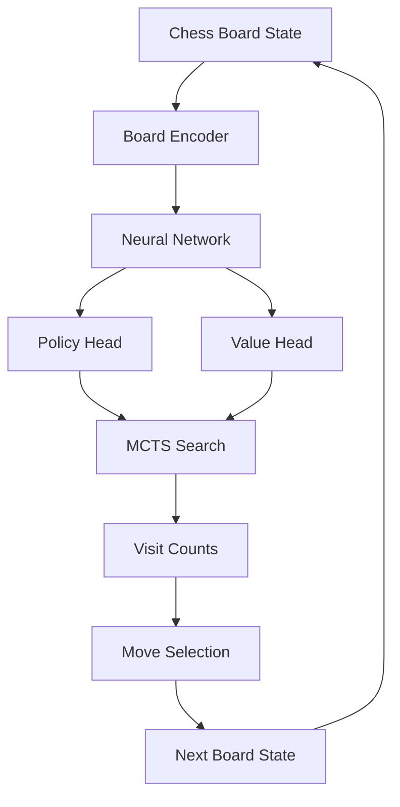
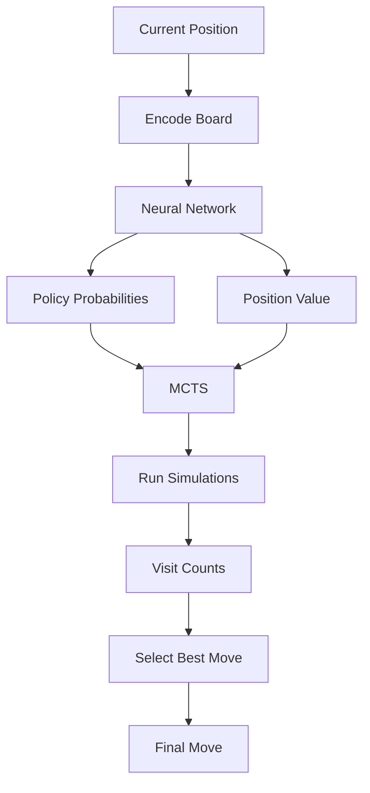
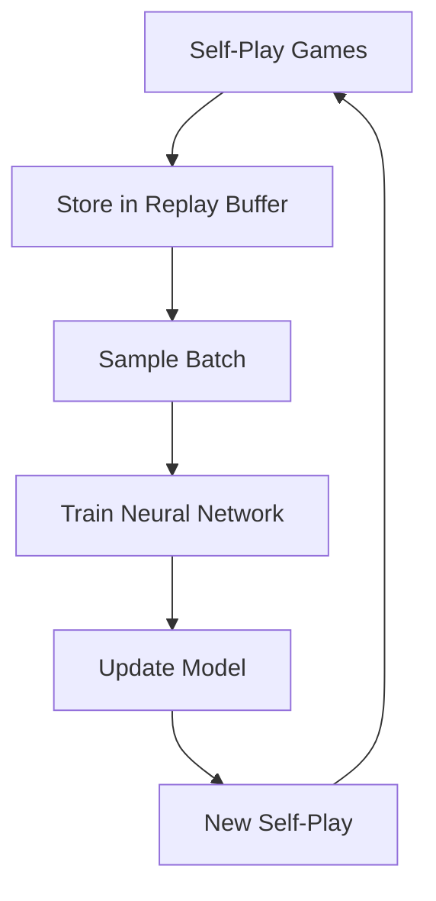

<div align="center">

# ♟️ AlphaZero-Style Chess AI  
### Self-Play Reinforcement Learning with MCTS & Deep Neural Networks


</div>

---

## Overview

This project implements an **AlphaZero-style chess engine from scratch**, combining:

- Deep Neural Networks (Policy + Value)
- Monte Carlo Tree Search (MCTS)
- Self-Play Reinforcement Learning

Unlike traditional chess engines, this system **learns purely from self-play**, without human data.

---

## Key Features

- Full chess environment using `python-chess`
- Board encoding into neural-friendly tensors (19×8×8)
- Residual CNN architecture (AlphaZero-style)
- Policy Head → move probabilities  
- Value Head → board evaluation (-1 to 1)
- MCTS with:
  - PUCT formula
  - Dirichlet noise (exploration)
  - Visit-based action selection
- Self-play training pipeline
- Replay buffer
- AlphaZero loss function
- Checkpointing system
- Model vs model evaluation

---

## System Architecture



---

## AI Decision Process



---

## Training Pipeline


---

## Project Structure

```
src/
├── engine/        # Chess logic & encoding
├── model/         # Neural network (policy + value)
├── mcts/          # Monte Carlo Tree Search
├── agents/        # MCTS agent
├── training/      # Self-play + training pipeline

tests/             # Unit tests
train_pipeline.py  # Full training loop
main.py            # Quick inference test
```

---


