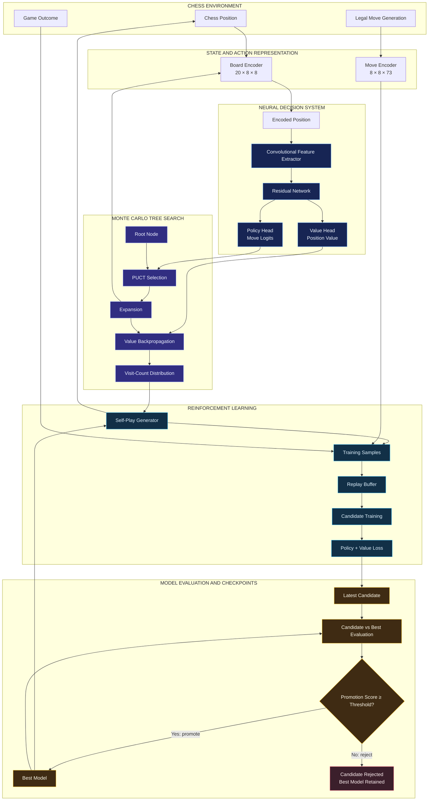
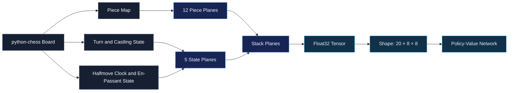
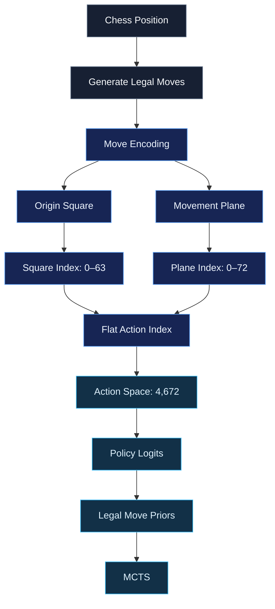
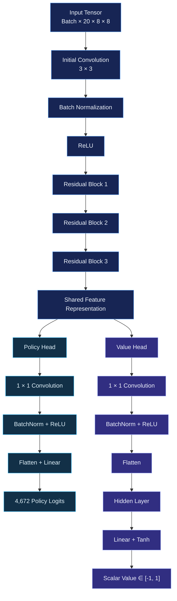
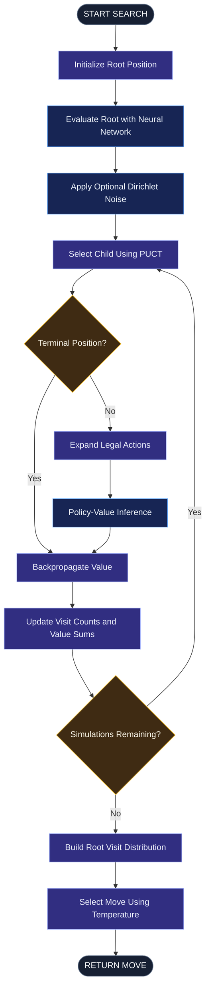
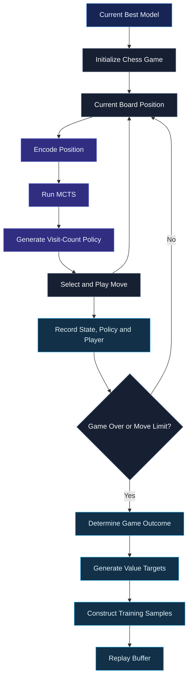
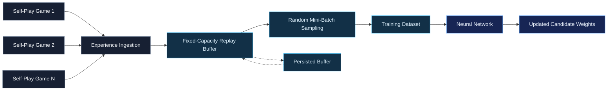
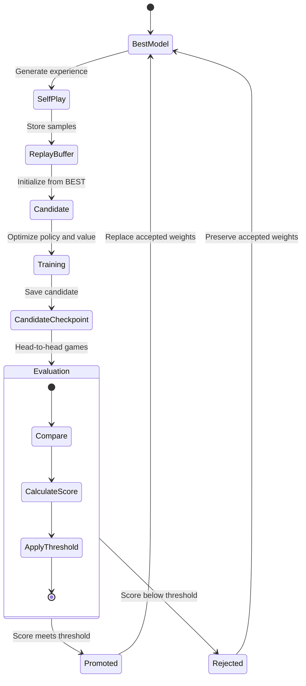
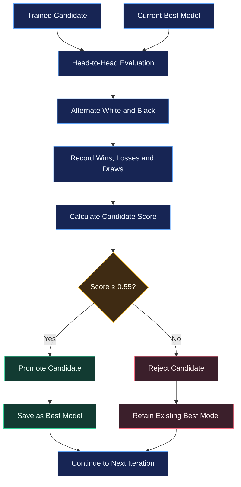
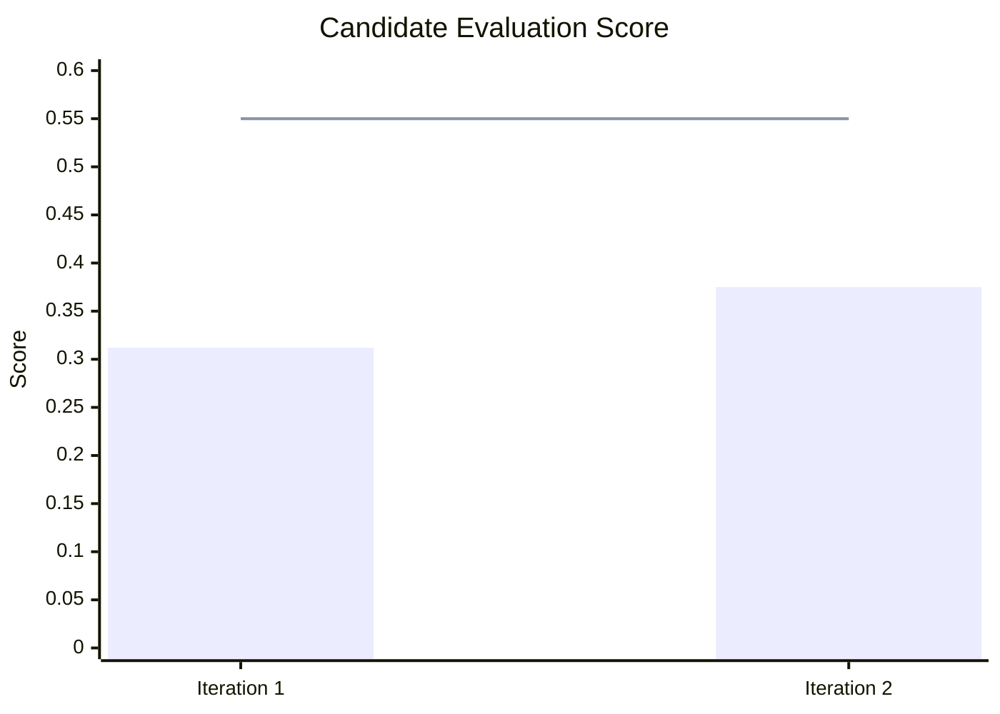

<div align="center">

# AlphaZero-Style Chess AI

### Self-Play Reinforcement Learning · Monte Carlo Tree Search · Policy-Value Neural Networks

**An experimental chess intelligence system that learns through self-play, searches through possible futures, and evaluates its own progress.**

<br/>

<p align="center">
  
  
  
  
</p>

<p align="center">
  
  
  
</p>

<p align="center">
  
  
  
  
</p>

[**Repository**](https://github.com/Nomusa990822/AlphaZero-Style-Chess-AI-Self-Play-Reinforcement-Learning-with-MCTS-and-Policy-Value-Networks) · [**Issues**](https://github.com/Nomusa990822/AlphaZero-Style-Chess-AI-Self-Play-Reinforcement-Learning-with-MCTS-and-Policy-Value-Networks/issues) · [**Architecture**](#02--system-architecture) · [**Results**](#10--experimental-training-results) · [**Run It**](#14--running-the-project)

</div>

---

## Contents

| | | |
|---|---|---|
| [01 Project Overview](#01--project-overview) | [07 Self-Play Experience Generation](#07--self-play-experience-generation) | [13 Installation](#13--installation) |
| [02 System Architecture](#02--system-architecture) | [08 Replay Buffer and Training](#08--replay-buffer-and-training) | [14 Running the Project](#14--running-the-project) |
| [03 Chess State Representation](#03--chess-state-representation) | [09 Candidate Training and Model Promotion](#09--candidate-training-and-model-promotion) | [15 Engineering Principles](#15--engineering-principles) |
| [04 Move Representation and Action Space](#04--move-representation-and-action-space) | [10 Experimental Training Results](#10--experimental-training-results) | [16 Current Development Priorities](#16--current-development-priorities) |
| [05 Policy-Value Neural Network](#05--policy-value-neural-network) | [11 Checkpoints and Experiment Tracking](#11--checkpoints-and-experiment-tracking) | [17 Research Foundation](#17--research-foundation) |
| [06 Monte Carlo Tree Search](#06--monte-carlo-tree-search) | [12 Repository Structure](#12--repository-structure) | [18 Project Status](#18--project-status) |

---

## 01 · Project Overview

This project is an independent, AlphaZero-inspired chess reinforcement-learning implementation built around the interaction of three central components:

- **Policy-value neural networks**: learn which moves are promising and how favourable a position is.
- **Monte Carlo Tree Search (MCTS)**: explores possible continuations using neural-network guidance.
- **Self-play reinforcement learning**: generates experience that becomes training data for subsequent model iterations.

Rather than depending entirely on handcrafted chess evaluation rules or a fixed opening database, the system generates positions through self-play and learns from the outcomes of its own games.

The objective is to develop a chess-playing agent whose decision-making improves through repeated cycles of search, experience generation, optimisation and evaluation.

> [!NOTE]
> **Development status: ongoing.** The architecture and training pipeline are implemented, and experimental training runs have been conducted. Further work is focused on improving learning stability, evaluation reliability, search efficiency and playing strength.

> [!IMPORTANT]
> This is an AlphaZero-inspired engineering project, not a reproduction of DeepMind's original AlphaZero implementation, training infrastructure or playing strength.

### At a Glance

| | |
|---|---|
| **Input representation** | 20 planes of 8 × 8 (piece placement, side to move, castling rights, move counters) |
| **Action space** | 4,672 moves (8 × 8 × 73) |
| **Network** | Convolutional trunk with 3 residual blocks (64 filters), policy head and value head |
| **Search** | PUCT-based Monte Carlo Tree Search with optional Dirichlet root noise |
| **Learning** | Self-play, bounded replay buffer (20,000 samples), policy and value loss |
| **Model gating** | Candidate must meet the score threshold and a confidence-bound improvement gate |
| **Engine** | `python-chess` for rules and legal moves |
| **Status** | Ongoing development; two experimental training iterations completed |

---

## 02 · System Architecture

The system is a feedback-driven learning architecture. Neural inference guides search; search generates improved policy targets; self-play converts those targets and game outcomes into experience; training updates a candidate network; and evaluation determines whether that candidate should replace the current best model.

### High-level architecture



The diagram describes the conceptual information flow. Individual components are implemented in separate Python modules to keep the system modular and testable.

### Architectural responsibilities

| Component | Responsibility |
|---|---|
| **Board encoder** | Converts chess positions into neural-network inputs |
| **Move encoder** | Maps legal chess moves to a fixed action space |
| **Policy-value network** | Produces move logits and position-value predictions |
| **MCTS** | Searches possible continuations using PUCT |
| **Self-play generator** | Produces games and training examples |
| **Replay buffer** | Retains a bounded collection of training experience |
| **Trainer** | Optimises the policy and value objectives |
| **Evaluator** | Compares candidate and current best models |
| **Checkpoint manager** | Persists model and optimiser states |
| **Metrics logger** | Records iteration-level training and evaluation results |

---

## 03 · Chess State Representation

A chess position must be converted into a numerical representation before it can be processed by the neural network. The current `BoardEncoder` produces a tensor with the shape:

```text
(20, 8, 8)
```

Each plane represents a particular aspect of the chess position.

### The 20-plane representation

| Plane | Representation |
|:---:|---|
| 0 | White pawns |
| 1 | White knights |
| 2 | White bishops |
| 3 | White rooks |
| 4 | White queens |
| 5 | White king |
| 6 | Black pawns |
| 7 | Black knights |
| 8 | Black bishops |
| 9 | Black rooks |
| 10 | Black queens |
| 11 | Black king |
| 12 | Side to move |
| 13 | White kingside castling rights |
| 14 | White queenside castling rights |
| 15 | Black kingside castling rights |
| 16 | Black queenside castling rights |
| 17 | Normalised halfmove clock |
| 18 | Normalised fullmove number |\n| 19 | En-passant target square (one-hot) |

The encoder preserves piece placement and selected game-state information in a spatial tensor suitable for convolutional processing.

### State encoding flow



> [!NOTE]
> The representation is a simplified AlphaZero-style starting point. It does not claim to reproduce every input feature used in the original system.

---

## 04 · Move Representation and Action Space

The project uses an AlphaZero-style move encoding with a fixed action space of:

$$8 \times 8 \times 73 = 4{,}672$$

Each of the 64 origin squares is associated with 73 possible move planes.

| Move category | Number of planes |
|---|:---:|
| Queen-like movement | 56 |
| Knight movement | 8 |
| Underpromotion movement | 9 |
| **Total** | **73** |

The 56 queen-like planes represent eight directions and seven possible distances. The knight planes encode the eight possible knight displacements. The underpromotion planes represent three directions and three promotion pieces: rook, bishop and knight.

Queen promotions are encoded as ordinary queen-like moves. Castling is represented as a king move.

### Legal action mapping



The policy network predicts across the complete action space. MCTS extracts and normalises the probabilities associated with the legal moves available in the current position.

---

## 05 · Policy-Value Neural Network

The neural network is the learned evaluation component of the system. It receives an encoded chess position and produces two complementary outputs:

1. A **policy distribution** over the action space.
2. A **scalar value estimate** for the current position.

### Network architecture

The implementation uses a shared convolutional feature extractor followed by residual blocks and two independent output heads.



### Current training network configuration

The configuration supplied to the training entry point uses:

| Parameter | Current value |
|---|---:|
| Input channels | 20 |
| Board dimensions | 8 × 8 |
| Convolution filters | 64 |
| Residual blocks | 3 |
| Value hidden-layer size | 128 |
| Policy action size | 4,672 |
| Value output | Scalar bounded by `tanh` |

The network defaults in the model class are configurable; the table above describes the configuration used by `train_pipeline.py`.

### Policy head

The policy head estimates which moves deserve attention. Its output is a vector of 4,672 logits, which are converted into probabilities during inference and used to give MCTS its move priors.

### Value head

The value head estimates the outcome potential of a position. Its output is a scalar bounded between -1 and +1:

| Value | Interpretation |
|:---:|---|
| +1 | Strongly favourable for the player to move |
| 0 | Approximately balanced |
| -1 | Strongly unfavourable for the player to move |

The two heads share learned features but optimise different prediction objectives.

---

## 06 · Monte Carlo Tree Search

MCTS provides the search mechanism through which the engine investigates possible chess continuations. Rather than choosing a move solely from the network's initial policy prediction, the search repeatedly explores a tree of possible positions.

The implementation uses PUCT, neural-network priors, visit counts, value estimates and optional Dirichlet noise at the root.

### MCTS search cycle



### Search phases

| Phase | Function |
|---|---|
| **Selection** | Traverses the existing tree using PUCT |
| **Expansion** | Creates child nodes for legal moves |
| **Evaluation** | Obtains policy priors and a value estimate |
| **Backpropagation** | Updates visit counts and accumulated values along the search path |
| **Move selection** | Selects an action using root visit counts and temperature |

### PUCT selection

The implementation computes the PUCT score using:

$$
PUCT(s,a) = Q(s,a) + c_{puct} \cdot P(s,a) \cdot \frac{\sqrt{N(s)}}{1+N(s,a)}
$$

Where:

- $Q(s,a)$ is the child value converted to the parent player's perspective (the negative of the child's side-to-move value).
- $P(s,a)$ is the policy prior.
- $N(s)$ is the parent visit count.
- $N(s,a)$ is the child visit count.
- $c_{\mathrm{puct}}$ controls exploration.

This balances exploitation of promising branches with exploration of less-visited actions.

### Dirichlet exploration

During self-play, optional Dirichlet noise is blended into the root move priors:

$$
P'(a)=(1-\epsilon)\,P(a)+\epsilon\,\eta_a
$$

Here, $\eta$ is sampled from a Dirichlet distribution. This introduces additional exploration into self-play decisions. The implementation also allows separate search configurations for training and evaluation.

### Temperature-based move selection

The search produces a move distribution based on child visit counts. Temperature controls how strongly the move selection favours the most visited child:

- Higher temperature encourages exploration.
- Lower temperature concentrates probability on the strongest search choices.
- Near-zero temperature selects the highest-visit child.

---

## 07 · Self-Play Experience Generation

Self-play is the source of the system's training experience. The current best model plays both sides of a chess game. At each position, MCTS searches the available continuations and generates a visit-count distribution.

The system records:

- Encoded board state
- MCTS policy target
- Player to move
- Final game outcome, transformed into the relevant player's perspective

### Self-play data pipeline



### Training sample structure

Each self-play sample contains:

| Field | Description |
|---|---|
| `state` | Encoded board tensor |
| `policy_target` | MCTS-derived probability distribution |
| `value_target` | Outcome-derived value for the player to move |
| `player_to_move` | Side whose decision produced the sample |

The current implementation also applies a small distance-from-game-end decay to value targets.

### Game termination

The self-play generator supports:

- Normal chess game termination
- Optional resignation
- Maximum move limits
- Optional adjudication when the move limit is reached

Resignation can be disabled through configuration. The current training entry point does so.

---

## 08 · Replay Buffer and Training

Training examples are retained in a bounded replay buffer. This allows the model to train on a broader collection of self-play experience instead of relying exclusively on the latest generated games.

### Replay buffer architecture



The replay buffer is implemented as a fixed-size deque. When its capacity is reached, older samples are displaced as new experience is added.

### Training objectives

The network is optimised using two loss components.

**Policy loss**: cross-entropy against the MCTS policy target:

$$
L_{\mathrm{policy}} = -\frac{1}{B}\sum_{i=1}^{B}\sum_a \pi_{i,a}\log p_{i,a}
$$

**Value loss**: mean squared error between predicted values and training targets:

$$
L_{\mathrm{value}} = \frac{1}{B}\sum_{i=1}^{B}(v_i - z_i)^2
$$

**Combined objective:**

$$
L = L_{\mathrm{policy}} + L_{\mathrm{value}}
$$

The training loop records total loss, policy loss, value loss and batch count for each epoch. Completed self-play games are written immediately to `self_play_games.jsonl`, and the replay buffer is saved after every game using an atomic file replacement.

---

## 09 · Candidate Training and Model Promotion

A trained candidate is not automatically accepted as the new best model. The pipeline separates the current best model from the candidate model. The candidate begins with a copy of the current best model's weights, is trained using replay-buffer experience, and is subsequently evaluated against the current best model.

This protects the accepted checkpoint from being overwritten by every training attempt.

### Model lifecycle



### Evaluation score

The evaluator calculates the candidate's score as:

$$
S = \frac{W + 0.5\,D}{G}
$$

Where $W$ is candidate wins, $D$ is draws and $G$ is the total number of games. The candidate and current best alternate colours during evaluation.

**The current configured promotion threshold is 0.55.**



> [!WARNING]
> The current evaluator uses a limited head-to-head game set and a material-based adjudication rule when its evaluation games reach the move limit. Evaluation scores should therefore be interpreted as experimental signals, not definitive estimates of playing strength.

---

## 10 · Experimental Training Results

The project has progressed beyond architecture design into actual training experiments. The results below are from a two-iteration training run using the configuration recorded for the current training pipeline.

### Experiment configuration

| Parameter | Value |
|---|---:|
| Device | CPU |
| Training iterations | 2 |
| Self-play games per iteration | 40 |
| Maximum self-play moves | 250 |
| Opening temperature moves | 30 |
| Opening temperature | 1.3 |
| Late temperature | 0.5 |
| Replay buffer capacity | 20,000 |
| Training batch size | 32 |
| Training epochs | 10 |
| Initial learning rate | 0.001 |
| Candidate learning rate | 0.0002 |
| Weight decay | 0.0001 |
| Training MCTS simulations | 80 |
| Evaluation MCTS simulations | 100 |
| Evaluation games | 24 |
| Promotion threshold | 0.55 |

### Observed results

| Metric | Iteration 1 | Iteration 2 |
|---|---:|---:|
| Final total loss | 5.3383 | 4.7476 |
| Final policy loss | 5.3073 | 4.7082 |
| Final value loss | 0.0310 | 0.0393 |
| Training batches | 313 | 621 |
| Evaluation wins | 6 | 7 |
| Evaluation losses | 15 | 13 |
| Evaluation draws | 3 | 4 |
| **Candidate score** | **0.312** | **0.375** |
| **Promotion decision** | Rejected | Rejected |

### Candidate evaluation



<sub>The horizontal line is the configured 0.55 promotion threshold.</sub>

### Interpretation

The second iteration produced a higher candidate evaluation score than the first. The recorded losses also decreased overall, although the value loss increased slightly between the two final epoch measurements.

Neither observation independently establishes a reliable improvement in playing strength.

Both candidates were rejected because their evaluation scores remained below the promotion threshold, so the existing best model was retained. This is an important outcome of the experiment: **the model-selection mechanism is functioning as a gate** rather than automatically promoting every newly trained candidate.

---

## 11 · Checkpoints and Experiment Tracking

The training pipeline separates accepted and experimental model states.

| Artifact | Purpose |
|---|---|
| `best_model.pt` | Accepted model used for subsequent training |
| `latest_candidate.pt` | Most recently trained candidate |
| `latest_buffer.pkl` | Persisted replay-buffer experience |
| `training_metrics.jsonl` | Iteration-level training metrics |
| `iteration_001_summary.json` | First iteration summary |
| `iteration_002_summary.json` | Second iteration summary |

The relevant data directories are:

```text
data/
├── checkpoints/
│   ├── best_model.pt
│   └── latest_candidate.pt
│
├── logs/
│   ├── training_metrics.jsonl
│   ├── iteration_001_summary.json
│   └── iteration_002_summary.json
│
└── replay_buffer/
    └── latest_buffer.pkl
```

> [!NOTE]
> The actual presence of individual generated artifacts depends on the training run and repository ignore rules. Model checkpoints and replay-buffer data should be preserved when they are needed to resume experiments.

---

## 12 · Repository Structure

The project separates the chess environment, neural architecture, search logic, agents and training pipeline.

```text
AlphaZero-Style-Chess-AI/
│
├── configs/
│
├── data/
│   ├── checkpoints/
│   ├── logs/
│   └── replay_buffer/
│
├── docs/
│
├── notebooks/
│
├── src/
│   ├── agents/
│   │   ├── human_agent.py
│   │   └── mcts_agent.py
│   │
│   ├── engine/
│   │   ├── encoder.py
│   │   └── move_encoding.py
│   │
│   ├── mcts/
│   │   ├── dirichlet_noise.py
│   │   ├── node.py
│   │   ├── puct.py
│   │   └── search.py
│   │
│   ├── model/
│   │   ├── inference.py
│   │   ├── network.py
│   │   ├── policy_head.py
│   │   ├── residual_block.py
│   │   └── value_head.py
│   │
│   └── training/
│       ├── checkpoint.py
│       ├── dataset.py
│       ├── evaluator.py
│       ├── loss.py
│       ├── metrics.py
│       ├── pipeline.py
│       ├── replay_buffer.py
│       ├── self_play.py
│       └── trainer.py
│
├── tests/
│
├── main.py
├── play.py
├── train_pipeline.py
├── requirements.txt
├── .gitignore
├── LICENSE
└── README.md
```

---

## 13 · Installation

### Requirements

- Python 3.10 or later
- PyTorch
- NumPy
- python-chess
- pytest for running the test suite

### Clone the repository

```bash
git clone https://github.com/Nomusa990822/AlphaZero-Style-Chess-AI-Self-Play-Reinforcement-Learning-with-MCTS-and-Policy-Value-Networks.git

cd AlphaZero-Style-Chess-AI-Self-Play-Reinforcement-Learning-with-MCTS-and-Policy-Value-Networks
```

### Create a virtual environment

```bash
python -m venv .venv
```

Linux / macOS:

```bash
source .venv/bin/activate
```

Windows:

```bash
.venv\Scripts\activate
```

### Install dependencies

```bash
pip install -r requirements.txt
```

The current requirements file specifies:

```text
python-chess>=1.999
numpy>=1.26.0
pytest>=8.0.0
torch>=2.2.0
```

---

## 14 · Running the Project

### Run the MCTS smoke test

```bash
python main.py
```

This initialises a chess board, constructs the model and inference pipeline, and asks the MCTS agent to select a move.

### Run the training pipeline

```bash
python train_pipeline.py
```

The training entry point constructs the board encoder, move encoder, network configuration and iterative training pipeline. It currently uses CPU execution and the two-iteration experimental configuration documented in [section 10](#10--experimental-training-results).

### Play against the AI

```bash
python play.py
```

The terminal interface supports:

- Playing as White or Black
- AI move selection using MCTS
- Loading a model checkpoint
- Configuring the number of simulations
- Entering moves in UCI notation

### Gameplay options

```bash
python play.py --help
```

| Argument | Purpose | Default |
|---|---|---|
| `--checkpoint` | Model checkpoint path | `data/checkpoints/best_model.pt` |
| `--human-color` | Human colour (`white` or `black`) | `white` |
| `--simulations` | MCTS simulations per AI move | `50` |

Example:

```bash
python play.py --human-color black --simulations 100
```

If no checkpoint exists at the specified path, the gameplay script reports that it is using an untrained model.

---

## 15 · Engineering Principles

| Principle | In practice |
|---|---|
| **Separation of concerns** | Board encoding, action encoding, inference, search, self-play, optimisation and evaluation are distinct components |
| **Learning through generated experience** | The system uses its own self-play games to construct training examples |
| **Search-guided decisions** | Neural-network predictions guide the search, while MCTS visit statistics influence the final move decision |
| **Controlled model replacement** | Candidate models must satisfy a promotion criterion before replacing the accepted model |
| **Experiment visibility** | Loss components, evaluation outcomes, replay-buffer size and checkpoints provide a record of the training process |
| **Honest performance reporting** | Training loss, evaluation score and chess playing strength are treated as different measurements; no playing-strength rating is claimed without an appropriate benchmark |

---

## 16 · Current Development Priorities

The project remains under active development.

| Area | Development direction |
|---|---|
| **Self-play** | Improve experience quality and game-generation efficiency |
| **Search** | Investigate search performance and simulation efficiency |
| **Neural network** | Experiment with model capacity and optimisation |
| **Evaluation** | Improve statistical reliability and evaluation methodology |
| **Training** | Investigate stability across longer training runs |
| **Data management** | Strengthen checkpoint and replay-buffer persistence |
| **Observability** | Improve visibility into self-play and training behaviour |
| **Benchmarking** | Establish repeatable playing-strength comparisons |

> [!NOTE]
> These are development priorities, not claims that the corresponding improvements have already been completed.

---

## 17 · Research Foundation

The project draws inspiration from the general approach described in:

> Silver, D. et al. (2018). *A general reinforcement learning algorithm that masters chess, shogi, and Go through self-play.* Science, 362(6419), 1140–1144.
> [Read the research paper](https://www.science.org/doi/10.1126/science.aar6404)

The implementation adapts the broad combination of self-play, policy-value learning and Monte Carlo Tree Search into an independent experimental project.

---

## 18 · Project Status

<p align="center"><sub><b>ONGOING DEVELOPMENT</b></sub></p>

This repository represents an evolving implementation of an AlphaZero-inspired chess learning system. The project already includes:

- [x] A 20-plane chess board representation
- [x] A 4,672-action move encoding
- [x] A residual policy-value neural network
- [x] PUCT-based Monte Carlo Tree Search
- [x] Self-play game generation
- [x] A bounded replay buffer
- [x] Policy and value optimisation
- [x] Candidate-versus-best model evaluation
- [x] Promotion gating and checkpoint management
- [x] A terminal interface for playing against the model

The next stage is to improve the quality, efficiency and reliability of the learning process through further experimentation.

The objective is not simply to build a chess-playing program. It is to engineer a system that can generate experience, learn from it, evaluate its own progress and iteratively develop its decision-making capability.

---

<div align="center">

### PLAY · SEARCH · LEARN · EVALUATE · REPEAT

*An independent exploration of reinforcement learning, neural search and self-improving game-playing systems.*

Built by [**Nomusa Shongwe**](https://github.com/Nomusa990822)

<sub>[Back to top](#alphazero-style-chess-ai)</sub>

</div>
